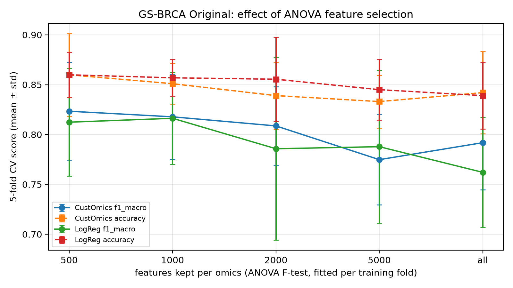
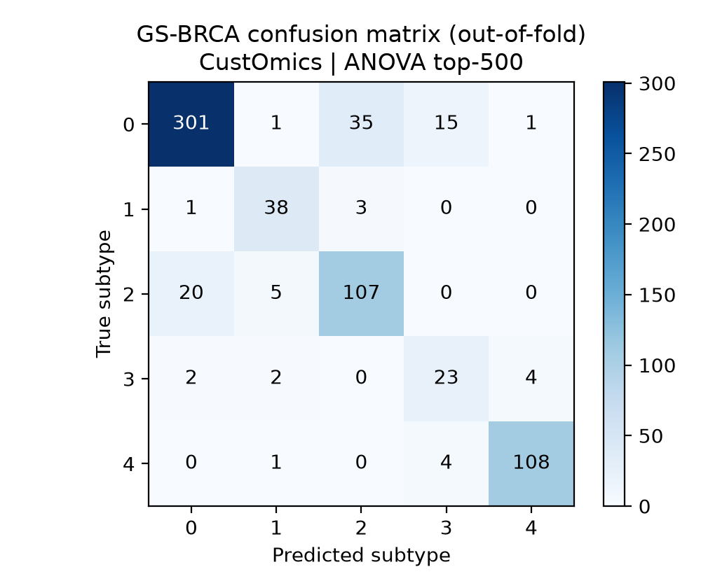
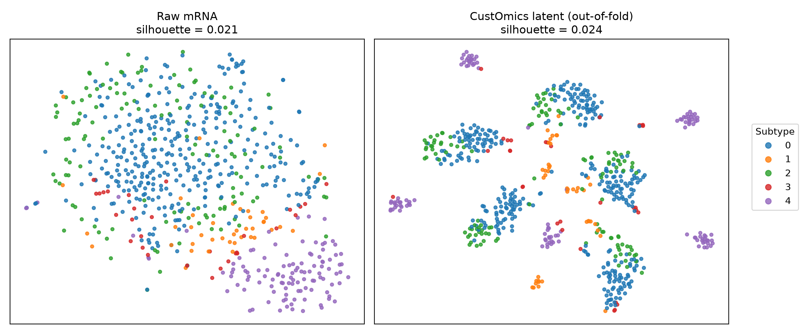

# Multi-Omics Cancer Classification with CustOmics

Final-year major project: classifying breast-cancer molecular subtypes (PAM50) from four omics layers using
**CustOmics**, a deep-learning model for multi-omics integration, trained on the
**MLOmics** cancer multi-omics benchmark.

This repository currently holds **notebook 03 — CustOmics on GS-BRCA with ANOVA F-test feature selection** — and all of its results.

---

## Highlights

| GS-BRCA (Original), stratified 5-fold CV | Accuracy | Macro-F1 | Macro-Recall | ROC-AUC |
|---|---|---|---|---|
| CustOmics, no feature selection (baseline, notebook 01) | 0.842 ± 0.041 | 0.792 ± 0.047 | 0.810 ± 0.033 | 0.958 ± 0.022 |
| **CustOmics, ANOVA top-500 per omics (this notebook)** | **0.860 ± 0.041** | **0.823 ± 0.049** | **0.854 ± 0.038** | 0.969 ± 0.022 |
| CustOmics, ANOVA top-1000 per omics | 0.851 ± 0.020 | 0.818 ± 0.043 | 0.842 ± 0.046 | 0.972 ± 0.014 |
| Logistic regression, ANOVA top-500 per omics | 0.860 ± 0.023 | 0.812 ± 0.054 | 0.802 ± 0.067 | 0.976 ± 0.007 |

- Selecting features **inside each training fold** adds +1.8 accuracy points and +3.2 macro-F1 points over using all ~57,000 features.
- Smaller is better: *k* = 500 > 1000 > 2000 > 5000 > all features. With 671 patients, most of the 57k features are noise.
- CustOmics ties logistic regression on accuracy. It scores higher on macro-F1 and macro-recall, so it is more balanced across subtypes.
- The selected genes are stable across folds and make biological sense: **32 of the 50 PAM50 genes** are chosen in every fold.

---

## Problem

| | |
|---|---|
| **Task** | 5-class PAM50 breast-cancer subtype classification |
| **Dataset** | MLOmics `GS-BRCA/Original` (TCGA breast cancer) |
| **Patients** | 671 |
| **Omics** | mRNA (18,206), DNA methylation (19,049), copy-number variation (19,568), miRNA (368): about 57,000 features in total |

Class distribution (imbalanced):

| Label | Subtype | Patients |
|---|---|---|
| 0 | Luminal A | 353 |
| 1 | HER2-enriched | 42 |
| 2 | Luminal B | 132 |
| 3 | Normal-like | 31 |
| 4 | Basal-like | 113 |

---

## Method

### 1. In-fold ANOVA feature selection
For each omics layer, the pipeline is `SimpleImputer(median) → SelectKBest(f_classif, k) → StandardScaler`.

- It is fitted **only on the training patients of each fold**. Validation and test patients never influence which features are kept, so there is no leakage.
- The top-*k* features are kept **per omics**, so every layer still contributes. miRNA (368 features) is kept whole.
- Sweep: *k* ∈ {500, 1000, 2000, 5000}, plus no selection as the reference point.

### 2. CustOmics model (mixed integration)
- **Phase 1: per-omics autoencoders.** Each omics layer has its own autoencoder that compresses it to a 64-D sub-latent. A small auxiliary classifier head on each one pushes the sub-latent to carry subtype signal, not just variance.
- **Phase 2: fusion and classification.** The four sub-latents are concatenated (*direct* fusion, 4 × 64 = 256-D) and passed to a classifier. Everything is then fine-tuned end-to-end with `reconstruction loss + 2 × cross-entropy`.
- **Class-weighted cross-entropy** (inverse class frequency) handles the subtype imbalance.

### 3. Evaluation protocol
- Stratified 5-fold cross-validation with seed 42. Within each training fold, 15% is held out as a validation set for early stopping only.
- The best epoch is picked by lowest validation cross-entropy, and its weights are restored with a true `copy.deepcopy`. This fixes a shallow-copy bug in the reference notebooks, which kept the *last* weights instead of the best ones.
- Metrics: accuracy, macro precision / recall / F1, one-vs-rest ROC-AUC, NMI and ARI.
- A logistic regression with the same in-fold selection serves as a classical baseline at every *k*.

### Final configuration (`results/brca_anova/config.json`)
| Parameter | Value | Parameter | Value |
|---|---|---|---|
| Omics | mRNA, Methy, CNV, miRNA | Top-*k* per omics | 500 |
| Latent dim (per omics) | 64 | Fusion | direct (concatenation) |
| Hidden units | 128 | Dropout | 0.5 |
| Learning rate | 1e-3 | Weight decay | 1e-3 |
| Batch size | 64 | Phase 1 / Phase 2 epochs | 20 / 150 (early stopping, patience 20) |
| CE weight | 2.0 | Folds | 5 |

---

## Results

### Effect of the number of selected features


### Per-subtype performance (pooled out-of-fold predictions, best model)
| Subtype | Precision | Recall | F1 | Support |
|---|---|---|---|---|
| Luminal A | 0.929 | 0.853 | 0.889 | 353 |
| HER2-enriched | 0.809 | 0.905 | 0.854 | 42 |
| Luminal B | 0.738 | 0.811 | 0.773 | 132 |
| Normal-like | 0.548 | 0.742 | 0.630 | 31 |
| Basal-like | 0.956 | 0.956 | 0.956 | 113 |
| **Macro avg** | 0.796 | 0.853 | 0.820 | 671 |

Feature selection helps the hard classes most: HER2-enriched F1 rose from 0.74 to 0.85, and Luminal B from 0.74 to 0.77.
Normal-like (only 31 patients) is still the hardest subtype.



### Latent space
Each patient is embedded by the fold model that never saw them during training (out-of-fold).



### Which features were selected?
| Omics | Features kept | Kept in all 5 folds | Mean pairwise Jaccard |
|---|---|---|---|
| mRNA | 500 | 382 | 0.773 |
| Methylation | 500 | 384 | 0.785 |
| CNV | 500 | 309 | 0.629 |
| miRNA | 368 | 368 | 1.000 |

- Top mRNA genes by F-score are **FOXA1, MLPH, FOXC1, ESR1, SPDEF, GATA3, AGR2, AGR3**: the textbook luminal-versus-basal markers.
- **32 of the 50 PAM50 genes** are selected in every fold.
- CNV is the least stable layer (Jaccard 0.63), which fits it carrying the weakest subtype signal.
- Full ranked lists are in `results/brca_anova/selected_features_<omics>.csv`.

---

## Repository structure

```
.
├── 03_brca_anova_customics.ipynb      # Notebook: ANOVA feature selection + CustOmics on GS-BRCA
├── README.md
└── results/
    └── brca_anova/
        ├── config.json                # Hyper-parameters of the best model
        ├── k_sweep_comparison.csv     # All CustOmics & LogReg runs (k = 500 … 5000, no selection)
        ├── k_sweep.png
        ├── cv_metrics_per_fold.csv    # Best model, metrics per test fold
        ├── cv_metrics_summary.csv     # Best model, mean ± std
        ├── per_class_metrics.csv
        ├── confusion_matrix.png
        ├── latent_tsne.png
        ├── oof_predictions.csv        # Out-of-fold class probabilities per patient
        ├── oof_latent.npy             # Out-of-fold 256-D latent vectors
        ├── selected_features_{mRNA,Methy,CNV,miRNA}.csv
        └── models/
            ├── fold_{1..5}.pt                 # Trained CustOmics weights per fold
            └── preprocess_fold_{1..5}.joblib  # Fitted imputer + ANOVA selector + scaler per fold
```

---

## Reproducing

1. **Get the data.** Download the MLOmics dataset and place the GS-BRCA files at
   `data/MLOmics/Main_Dataset/Classification_datasets/GS-BRCA/Original/`
   (`BRCA_mRNA.csv`, `BRCA_Methy.csv`, `BRCA_CNV.csv`, `BRCA_miRNA.csv`, `BRCA_label_num.csv`).
   The raw data is not included in this repository because of its size.
2. **Install the dependencies** (Python 3.10+):
   ```bash
   pip install torch numpy pandas scikit-learn matplotlib joblib jupyter
   ```
3. **Run** `03_brca_anova_customics.ipynb` from the repository root. A CUDA GPU is optional but recommended. The original run used an NVIDIA RTX 4050 Laptop GPU, and each 5-fold CustOmics run took under a minute.

### Loading a saved fold model
```python
import joblib, torch
pre = joblib.load("results/brca_anova/models/preprocess_fold_1.joblib")   # dict: omics -> fitted pipeline
state = torch.load("results/brca_anova/models/fold_1.pt", map_location="cpu")
# Rebuild CustOmics (class definitions are in the notebook) with the settings in config.json, then load_state_dict(state)
```

---

## References
- Benkirane, H. et al. *CustOmics: A versatile deep-learning based strategy for multi-omics integration.* PLOS Computational Biology (2023).
- Yang, Z. et al. *MLOmics: Cancer Multi-Omics Database for Machine Learning.* (2024).
- Parker, J. S. et al. *Supervised risk predictor of breast cancer based on intrinsic subtypes (PAM50).* Journal of Clinical Oncology (2009).
